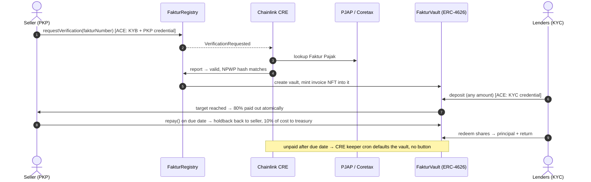

<p align="center">
  
</p>

<h1 align="center">Fakturin</h1>

<p align="center">
  <b>Verified invoices, funded today.</b><br/>
  Invoice financing for Indonesian small businesses: a Faktur Pajak checked with the tax system by Chainlink,
  locked as an NFT in its own ERC-4626 vault, and funded by KYC'd lenders together.
</p>

<p align="center">
  <a href="https://www.fakturin.xyz">Live app</a> ·
  <a href="https://docs.fakturin.xyz">Documentation</a> ·
  <a href="https://sepolia.arbiscan.io/address/0xB0f57cbe61bB207Bcd9778f241280c28A74f2030#code">Contracts on Arbiscan</a> ·
  <a href="https://youtu.be/eNvSw1OGI8c">Pitch video</a> ·
  <a href="https://youtu.be/GkPqmEKnXow">Demo video</a>
</p>

<p align="center">
  <a href="https://github.com/demigohu/fakturin/actions/workflows/ci.yml"></a>
  
  
  
  
</p>

> Ethereum Jakarta Hackathon 2026, **Real-World Assets** track: credit & lending, supply chain & trade finance,
> identity & compliance.

---

## The problem

Indonesian suppliers sell on credit and wait to be paid. In Indonesia **54% of B2B sales are on credit, the
average term is 50 days and 49% of invoices are paid late** ([Atradius Payment Practices Barometer, Asia 2025](https://atradius.de/dam/jcr:a5138c1e-7aa7-48b4-82d7-64a3d938d31d/payment-practices-barometer-asia-2025-indonesia-en.pdf)).
Invoice financing would fix their cash flow, but lenders hold back for two reasons:

1. **Double financing.** The same invoice can be pledged to several lenders who cannot see each other.
2. **Ownership.** Anyone who knows an invoice number can claim to be its seller.

## The solution

Since January 2025 every Indonesian VAT invoice (**Faktur Pajak**) is issued in the tax office's Coretax system
with a **unique national number** and the **NPWP (tax ID) of seller and buyer**. Fakturin turns that public
infrastructure into an onchain credit primitive:

| Risk                    | How Fakturin removes it                                                                                                                                                             |
| ----------------------- | ----------------------------------------------------------------------------------------------------------------------------------------------------------------------------------- |
| Fake invoice            | A **Chainlink CRE** workflow asks the tax system (through a PJAP, a licensed tax application provider) whether the Faktur Pajak exists and is valid, and writes the answer onchain. |
| Somebody else's invoice | The seller proves its NPWP once with a **Chainlink ACE** credential. The NPWP on the Faktur Pajak must match, or the invoice is rejected (`SELLER_MISMATCH`).                       |
| Double financing        | The registry key is the national Faktur Pajak number. Once financed, it can **never** be financed again. The invoice NFT is locked in one vault.                                    |
| Anonymous money         | Lenders pass KYC once (ACE credential); vaults refuse deposits from anyone else.                                                                                                    |
| Seller does not repay   | 17% of the funds stay in the vault as a holdback for lenders; the seller is flagged onchain forever.                                                                                |

**For a Rp100M invoice due in 60 days:** lenders put in Rp97M together → the seller gets **Rp80M the moment the
vault fills** → on the due date the seller repays Rp100M and gets the Rp17M holdback back (net cost 3%) →
lenders withdraw **Rp99.7M (+2.78%, ~17% a year)** → Fakturin keeps Rp0.3M, only because the loan was repaid.

## How it works



Full architecture, sequence diagrams for every path, money flow and the trust model:
**[docs.fakturin.xyz/docs/architecture](https://docs.fakturin.xyz/docs/architecture)**.

## Why it scores on the judging criteria

| Criterion                              | What we built                                                                                                                                                                                                                                                                                                                                                                                                                                               |
| -------------------------------------- | ----------------------------------------------------------------------------------------------------------------------------------------------------------------------------------------------------------------------------------------------------------------------------------------------------------------------------------------------------------------------------------------------------------------------------------------------------------- |
| **Real-world utility** (25%)           | A real, measured problem (late B2B payments) for a real user (PKP suppliers), built on a real national registry (Coretax Faktur Pajak numbers and NPWP). Pricing is 1.5% per 30 days all-in, under the OJK cap of 0.067%/day; one vault per invoice respects POJK 40/2024's ban on automatic pooling.                                                                                                                                                       |
| **Onchain implementation** (25%)       | 8 custom contracts plus a self-deployed Chainlink ACE stack: 19 contracts deployed, all verified on Arbiscan. The rules that matter are enforced onchain: uniqueness of the invoice, NPWP ownership match, KYC-gated ERC-4626 deposits, all-or-nothing funding with atomic payout, holdback, fee only on repayment, default flag, non-transferable shares, an onchain SVG NFT, and permissionless/automated closing. Nothing is "blockchain as a database". |
| **Innovation & differentiation** (20%) | Uses the **national tax invoice** as the anti-double-financing key and the **seller's tax ID inside an onchain credential** as the ownership proof, instead of trusting uploaded PDFs or an operator's word. Combines **Chainlink CRE** (tax-office oracle and keeper) with **Chainlink ACE** (identity and compliance) in one flow.                                                                                                                        |
| **Feasibility & scalability** (20%)    | Every simulated part sits behind a real interface: swap the PJAP mock URL for a licensed PJAP, the issuer route for a licensed e-KYC/KYB provider, MockIDRX for IDRX. Contracts are non-upgradeable with immutable vault terms; per-invoice vaults isolate risk. Scaling notes (indexer, ERC-1167 clones, DON deployment) in [System design](https://docs.fakturin.xyz/docs/architecture/system-design).                                                    |
| **Demo & UX** (10%)                    | Three plain-language screens (Borrow, Lend, Check). Every transaction opens a review dialog that explains each step, shows exact approval amounts and raw calldata. KYC/KYB is one free signature. Closing overdue vaults needs no button. Demo shortcuts let judges see repay, default and rejection paths in minutes.                                                                                                                                     |

## Try it

1. Open **[fakturin.xyz](https://www.fakturin.xyz)** with any EVM wallet on **Arbitrum Sepolia** (a little test ETH for gas).
2. **Get test MockIDRX** from the faucet button.
3. **Borrow**: verify your business (free signature) → pick a Faktur Pajak → submit → Chainlink verifies it in seconds.
4. From a second wallet, **Lend**: pass KYC (free signature) → fund the invoice → the seller is paid 80% instantly.
5. **Repay** from the seller, then **Withdraw** from the lender. Look the number up on **Check**: the NFT is stamped LUNAS.

Demo shortcuts (last four digits of the Faktur Pajak number): `7777` = due in 2 minutes (watch the keeper default
it), `9999` = cancelled, `8888` = replaced, `0000` = not found. Step-by-step guides:
[borrower](https://docs.fakturin.xyz/docs/guides/borrower), [lender](https://docs.fakturin.xyz/docs/guides/lender).

## Deployed contracts (Arbitrum Sepolia, chain 421614)

| Contract                     | Address                                                                                                                             |
| ---------------------------- | ----------------------------------------------------------------------------------------------------------------------------------- |
| FakturRegistry               | [`0xB0f57cbe61bB207Bcd9778f241280c28A74f2030`](https://sepolia.arbiscan.io/address/0xB0f57cbe61bB207Bcd9778f241280c28A74f2030#code) |
| FakturVaultFactory           | [`0x1e95cbab178772A8d7fE2Cb7a62760A479Dfbc53`](https://sepolia.arbiscan.io/address/0x1e95cbab178772A8d7fE2Cb7a62760A479Dfbc53#code) |
| FakturNFT                    | [`0x97fe1401dA1e167C964284344f8D8C00F60c7e66`](https://sepolia.arbiscan.io/address/0x97fe1401dA1e167C964284344f8D8C00F60c7e66#code) |
| FakturRenderer               | [`0x713afe0eB8B09C2dEA3f0A360D9ac74348Ece8DD`](https://sepolia.arbiscan.io/address/0x713afe0eB8B09C2dEA3f0A360D9ac74348Ece8DD#code) |
| FakturVerifierReceiver (CRE) | [`0xDaE568EA803859DE11fe43a385a219174A7f7975`](https://sepolia.arbiscan.io/address/0xDaE568EA803859DE11fe43a385a219174A7f7975#code) |
| FakturKeeper (CRE)           | [`0xdd2785e1AB472838bD196837Dd5716372fef10a3`](https://sepolia.arbiscan.io/address/0xdd2785e1AB472838bD196837Dd5716372fef10a3#code) |
| MockIDRX (test rupiah)       | [`0x11fdaa711602C6b5cE4DeF19028a56b2f07Be22E`](https://sepolia.arbiscan.io/address/0x11fdaa711602C6b5cE4DeF19028a56b2f07Be22E#code) |
| ACE PolicyEngine             | [`0xA159ab1D85482c51ad0856Ab73CF52C6f9006213`](https://sepolia.arbiscan.io/address/0xA159ab1D85482c51ad0856Ab73CF52C6f9006213#code) |
| ACE IdentityRegistry         | [`0x9A1149837d01e6Afe66463531768F5FE96D38435`](https://sepolia.arbiscan.io/address/0x9A1149837d01e6Afe66463531768F5FE96D38435#code) |
| ACE CredentialRegistry       | [`0x3DFBb1B4f66b718Add7a1292ACaaa6bb69DBF777`](https://sepolia.arbiscan.io/address/0x3DFBb1B4f66b718Add7a1292ACaaa6bb69DBF777#code) |

Full list (validators, issuer policy, operator): [Deployed addresses](https://docs.fakturin.xyz/docs/reference/deployments).

## Real vs simulated

We are explicit about what is a demo stand-in. Each simulated part is labelled in the UI.

| Real                                                                                                | Simulated (same interface as the real thing)                   |
| --------------------------------------------------------------------------------------------------- | -------------------------------------------------------------- |
| All Fakturin contracts and the Chainlink ACE identity stack, verified on Arbiscan                   | Tax-office data: a PJAP-shaped API (`/api/pjap`)               |
| Chainlink CRE workflows (verify + keeper), running via `cre workflow simulate --broadcast` on a VPS | KYC/KYB provider that issues the ACE credentials               |
| Invoice registry, NPWP match, vaults, payout, repay, default, fee, NFT                              | Rupiah: **MockIDRX**, a 2-decimal test copy of IDRX, not money |

CRE runs in simulation mode because deploying workflows to the Chainlink DON requires a commercial agreement.
The onchain receivers only accept reports through Chainlink's forwarder either way.

## Tech stack

| Layer                 | Stack                                                                                                                              |
| --------------------- | ---------------------------------------------------------------------------------------------------------------------------------- |
| Chain                 | Arbitrum Sepolia                                                                                                                   |
| Contracts             | Solidity 0.8.28, Foundry (`via_ir`), OpenZeppelin 5.1 (ERC-4626, ERC-721, AccessControl)                                           |
| Identity & compliance | Chainlink ACE: PolicyEngine, OnlyAuthorizedSenderPolicy, IdentityRegistry, CredentialRegistry, CredentialRegistryIdentityValidator |
| Oracle & automation   | Chainlink CRE (TypeScript SDK, EVM log trigger, HTTP capability, cron), pm2                                                        |
| Frontend              | Next.js 16, React 19, wagmi + viem, Reown AppKit, GSAP                                                                             |
| Docs                  | Fumadocs, Mermaid                                                                                                                  |
| Monorepo              | Turborepo, npm workspaces                                                                                                          |

## Repository

```
apps/
  contracts-solidity/   Solidity contracts, tests, deploy scripts  → README
  fakturin-cre/         Chainlink CRE workflows (verify, keeper)   → README
  web/                  The dApp: /borrow, /lend, /check           → README
  docs/                 docs.fakturin.xyz (Fumadocs)               → README
packages/
  abis/                 Contract ABIs shared by web and CRE
docs/
  PRD.md                Product requirements (Indonesian)
  TESTING.md            End-to-end test guide (Indonesian)
```

| Package       | Read                                                                   |
| ------------- | ---------------------------------------------------------------------- |
| Contracts     | [apps/contracts-solidity/README.md](apps/contracts-solidity/README.md) |
| CRE workflows | [apps/fakturin-cre/README.md](apps/fakturin-cre/README.md)             |
| Web app       | [apps/web/README.md](apps/web/README.md)                               |
| Docs site     | [apps/docs/README.md](apps/docs/README.md)                             |

## Run locally

Requires Node 24+, npm 11, and [Foundry](https://getfoundry.sh).

```bash
git clone --recurse-submodules https://github.com/demigohu/fakturin.git
cd fakturin
npm install

# contracts
cd apps/contracts-solidity && forge test && cd ../..

# web app (fill in the addresses from the table above)
cp apps/web/.env.example apps/web/.env
npm run dev              # web on :3000, docs on :3001
```

Already cloned without submodules? `git submodule update --init --recursive`.

## Built during the hackathon

Everything in this repository was written for Ethereum Jakarta Hackathon 2026, starting from an empty
`create-turbo` scaffold (first commit). Third-party code we build on, unmodified:

| Dependency                                                                           | Use                                                       | License                      |
| ------------------------------------------------------------------------------------ | --------------------------------------------------------- | ---------------------------- |
| [OpenZeppelin Contracts](https://github.com/OpenZeppelin/openzeppelin-contracts) 5.1 | ERC-4626, ERC-721, ERC-20, AccessControl, ReentrancyGuard | MIT                          |
| [Chainlink ACE](https://github.com/smartcontractkit/chainlink-ace) (`60f04505`)      | Identity, credentials, policy engine (self-deployed)      | BUSL-1.1, non-production use |
| [Chainlink CRE SDK](https://docs.chain.link/cre)                                     | Workflow runtime                                          | see package                  |
| [forge-std](https://github.com/foundry-rs/forge-std)                                 | Tests and scripts                                         | MIT / Apache-2.0             |
| Next.js, wagmi, viem, Reown AppKit, Fumadocs, Mermaid                                | Frontend and docs                                         | see packages                 |

## Roadmap

PJAP staging access → CRE on the Chainlink DON → licensed KYC/KYB issuer → IDRX on Arbitrum → indexer and
ERC-1167 vault clones → non-PKP sellers verified from accounting software. Details:
[Limitations and roadmap](https://docs.fakturin.xyz/docs/roadmap).

## Demo

| Video                                                           | Link                                                 |
| --------------------------------------------------------------- | ---------------------------------------------------- |
| Pitch (~85 s): problem, solution, how it works, proof           | [youtu.be/eNvSw1OGI8c](https://youtu.be/eNvSw1OGI8c) |
| Product demo: borrow, lend, repay, rejection, automatic default | [youtu.be/GkPqmEKnXow](https://youtu.be/GkPqmEKnXow) |

## Team

<!-- Name, role, GitHub / X for each member. -->

| Name                | Role    |
| ------------------- | ------- |
| Tegar Aji Kurniawan | Founder |

---

<sub>Fakturin is a hackathon prototype on a test network. MockIDRX is not money and is not affiliated with IDRX.
Tax-office and identity data are simulated. Not a financial product; contracts are not audited.</sub>
