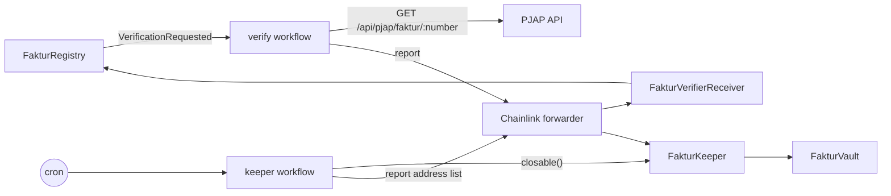

# Fakturin: Chainlink CRE workflows

Two [Chainlink CRE](https://docs.chain.link/cre) workflows do the jobs Fakturin's contracts cannot do by
themselves: ask the tax system about an invoice, and close vaults when their deadlines pass.

| Workflow | Trigger | What it does | Writes to |
| --- | --- | --- | --- |
| [`verify/`](verify/workflow.ts) | EVM log `FakturRegistry.VerificationRequested` | Fetches the Faktur Pajak from PJAP, maps it to a `Verification` report (validity, seller and buyer NPWP hashes, amount, dates) | `FakturVerifierReceiver.onReport` → `FakturRegistry.fulfillVerification` |
| [`keeper/`](keeper/workflow.ts) | Cron | Reads `FakturKeeper.closable(10)`; if any vault is overdue, reports their addresses | `FakturKeeper.onReport` → `cancelFunding` / `markDefault` per vault |

Both receivers accept reports only from Chainlink's forwarder. The registry then applies its own checks, notably
the **NPWP match**: the seller NPWP hash in the report must equal the requesting wallet's Chainlink ACE PKP
credential, or the invoice is rejected (`SELLER_MISMATCH`).



## Simulation mode

Chainlink lets anyone run workflows with `cre workflow simulate`. With `--broadcast` the simulation sends **real
transactions** through Chainlink's simulation forwarder `0xD41263567DdfeAd91504199b8c6c87371e83ca5d`, which is the
forwarder our receivers trust. Deploying workflows to the Chainlink DON needs a commercial agreement, so Fakturin
runs the simulator as an always-on service:

| Script | Runs | Why |
| --- | --- | --- |
| [`scripts/verify-listen.sh`](scripts/verify-listen.sh) | `cre workflow simulate verify --listen --broadcast` | Stays subscribed to new logs; verifies each request in about 3 s |
| [`scripts/keeper-loop.sh`](scripts/keeper-loop.sh) | `cre workflow simulate keeper` every `KEEPER_INTERVAL` s (default 60) | Cron triggers cannot `--listen`, so the loop is the clock; the workflow is compiled once and reused |
| [`ecosystem.config.cjs`](ecosystem.config.cjs) | Both scripts under pm2 | Auto-restart, logs, survives reboots |

The web app has an equivalent relayer for both jobs (`NEXT_PUBLIC_VERIFIER=relayer`). Set
`NEXT_PUBLIC_VERIFIER=cre` in the web app once these processes are running.

## Requirements

- [CRE CLI](https://docs.chain.link/cre) 1.38+, logged in (`cre whoami`). "Deploy Access: Not enabled" is fine; simulation does not need it.
- [Bun](https://bun.sh) (compiles the TypeScript workflows)
- A wallet with a little Arbitrum Sepolia ETH (pays gas for the reports; needs no role)
- pm2 for a server: `npm i -g pm2`

## Configuration

| File | Keys |
| --- | --- |
| `.env` (from `.env.example`, gitignored) | `CRE_ETH_PRIVATE_KEY`, `CRE_TARGET=staging-settings`, optional `CRE_API_KEY`, `KEEPER_INTERVAL` |
| [`verify/config.json`](verify/config.json) | `registryAddress`, `receiverAddress`, `pjapBaseUrl` (`https://www.fakturin.xyz/api/pjap/faktur`), `chainName`, `gasLimit` |
| [`keeper/config.json`](keeper/config.json) | `keeperAddress`, `schedule`, `maxPerRun`, `chainName`, `gasLimit` |
| [`project.yaml`](project.yaml) | RPCs per target: `staging-settings` = Arbitrum Sepolia, `local-settings` = anvil on `127.0.0.1:8545` |

`pjapBaseUrl` must be reachable from the machine running the workflow. Point it at the final URL (no redirects).

## Run on a laptop

```bash
cd apps/fakturin-cre
(cd verify && bun install) && (cd keeper && bun install)
cp .env.example .env            # CRE_ETH_PRIVATE_KEY, CRE_TARGET=staging-settings
cre login

./scripts/verify-listen.sh      # terminal 1
./scripts/keeper-loop.sh        # terminal 2
```

## Run on a VPS with pm2

```bash
# once
apt-get install -y unzip && curl -fsSL https://bun.sh/install | bash && source ~/.bashrc
npm i -g pm2
# install the CRE CLI: https://docs.chain.link/cre

git clone https://github.com/demigohu/fakturin.git && cd fakturin/apps/fakturin-cre
(cd verify && bun install) && (cd keeper && bun install)
cp .env.example .env && nano .env
```

**Logging in on a server without a browser.** `cre login` waits for a callback on the server's
`localhost:53682`, but your browser redirects to your laptop's `localhost`. Either:

- SSH with a tunnel and log in through it: `ssh -L 53682:localhost:53682 user@server`, then `cre login` and open
  the printed URL on your laptop; or
- open the URL on your laptop, copy the failed `http://localhost:53682/callback?code=…&state=…` address, and on the
  server (second SSH session, while `cre login` is still waiting) run `curl "<that URL>"`; or
- set `CRE_API_KEY` in `.env`.

Check by hand first, then hand over to pm2:

```bash
./scripts/verify-listen.sh       # "listening", Ctrl+C
./scripts/keeper-loop.sh         # "No overdue vaults" / "keeper tick…", Ctrl+C

pm2 start ecosystem.config.cjs   # start it from a shell where `which cre` works: pm2 keeps that PATH
pm2 save && pm2 startup
pm2 logs fakturin-cre-verify     # VerificationRequested … PJAP result … Verification written: 0x…
pm2 logs fakturin-cre-keeper     # No overdue vaults | Closing 1 vault(s) … Keeper report written
```

Update later with `git pull && pm2 restart all`.

## Troubleshooting

| Symptom | Fix |
| --- | --- |
| An invoice stays "Checking" | The listener was down when it was submitted (it starts at the current block). Replay it: `cre workflow simulate verify --broadcast --non-interactive --trigger-index 0 --evm-tx-hash 0x<submit tx> --evm-event-index 0 -T staging-settings` |
| `You are not logged in` | See "Logging in on a server" above, or `CRE_API_KEY` |
| `bun: command not found` under pm2 | The scripts add `~/.bun/bin` to `PATH`; make sure bun is installed for the same user that runs pm2 |
| Listener logs keep "scanning" | Normal: it polls each new block for logs |
| PJAP request fails | `curl` the `pjapBaseUrl` + a number from the server; avoid URLs that redirect |
| Keeper report reverts with `InsufficientGas` | Raise `gasLimit` in `keeper/config.json` (each close reserves 250k gas) |

## Local anvil fork

```bash
anvil --fork-url https://sepolia-rollup.arbitrum.io/rpc --chain-id 421614 --block-time 1
# deploy with apps/contracts-solidity (see its README), then put the local addresses in
# verify/config.local.json and keeper/config.local.json (gitignored) and use an anvil key:
CRE_ENV_FILE=.env.local-fork CRE_TARGET=local-settings ./scripts/verify-listen.sh
CRE_ENV_FILE=.env.local-fork CRE_TARGET=local-settings KEEPER_INTERVAL=30 ./scripts/keeper-loop.sh
```

The fork keeps chain ID 421614, so Chainlink's simulation forwarder address works unchanged.

## Not used

`nav/`, `por/`, `settlement/`, `contracts/` and `scripts/run-simulate.sh` are CRE template examples kept for
reference; Fakturin only uses `verify/` and `keeper/`.
